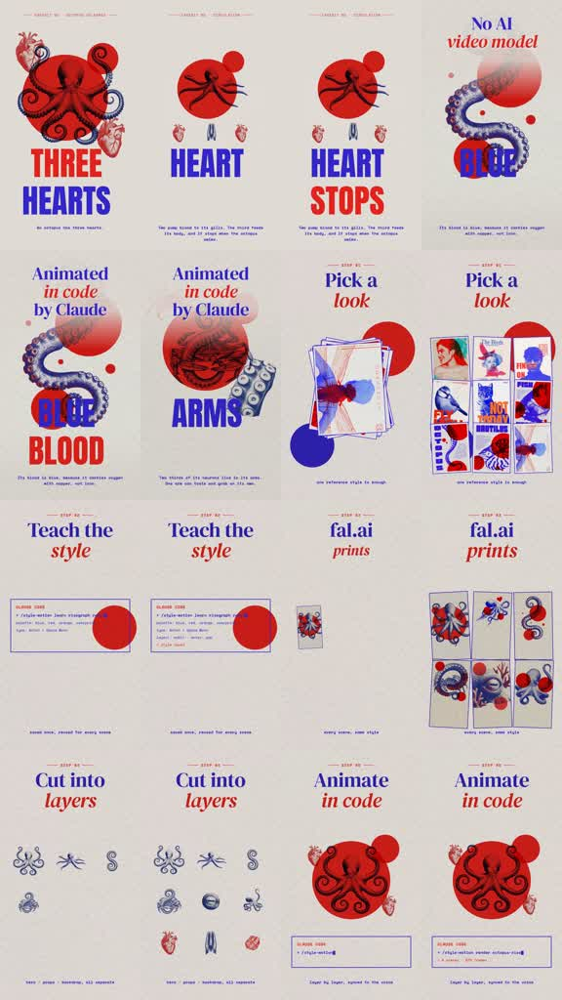
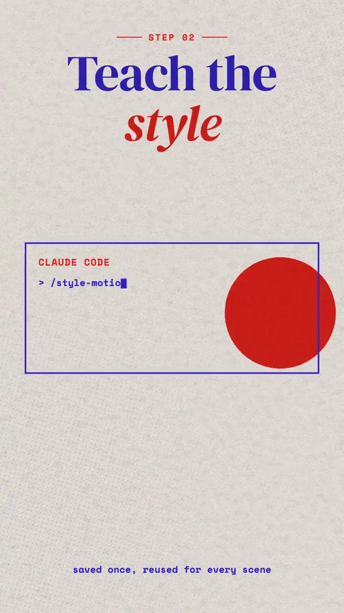

# /bodyatlas: Octopus infographic tutorial

**Source-specific command:** `/bodyatlas How I animated a whale-heart fact card`

The [original clip](../../reference-videos/source-04.mp4) runs about 40 s in 9:16. Its source-specific structure is below. This new prompt uses the same audiovisual grammar with new wording and original visuals.

## Source beat map

| Source interval | Source visual role | Script role |
|---|---|---|
| 0–8 s | Three hearts / heart stops / moving blood graphic sequence | Deliver the science hook |
| 8–15 s | Large process claim and octopus motif | Pivot to how it was made |
| 15–21 s | Reference poster collage | Pick a look |
| 21–31 s | Rule card then printed art grid | Teach style consistency and scene creation |
| 31–40 s | Separated organs and tentacles then assembled animated octopus | Prove layer animation |

## Original script sketch

These are new example lines, not a transcript of the source. They show how spoken meaning maps to a shot. Measure an actual voice recording before assigning final seconds.

| Beat | Spoken draft | Matching image |
|---|---|---|
| 1 | A whale has a heart the size of a small car. | Huge anatomical fact card; fact must be checked |
| 2 | The beat moves blood through its body. | Second bold organ card |
| 3 | I built the illustration in five parts. | Process pivot and art layers |
| 4 | I matched every scene to one poster style. | Style card and scene grid |
| 5 | Then I animated each part to the voice. | Layer motion and assembled heart |

## New-topic production brief

**Hook:** Teach one striking science fact with bold anatomical art in the first eight seconds, then reveal the art-making process.

**Visual rules:** Off-white paper, huge cobalt and scarlet serif/block type, three-heart octopus imagery, red circles, blue tentacles, science-poster reference cards and isolated organ/limb grids.

**Voice and sound:** Energetic instructor voice; light rhythmic bed and a punch on each big fact word, then softer craft cues for the five steps.

**Adaptation:** Pick one verified fact that can be visualized in three graphic cards; use its art as the object of the tutorial.

Draft original lines against these beat roles; record them and replace the source intervals with real voice timings. Each shot must illustrate its current phrase. Use the source as a style reference, not a set of frames to reuse.

**Check:** Verify all biological claims independently.
