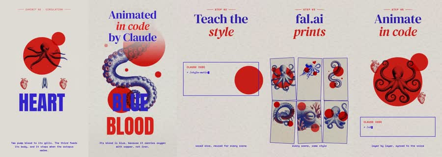

# Body Atlas: worked example

**Try:** `/bodyatlas How a heartbeat moves blood`

**Reference basis:** Observed, 4. The source clip is stored at [source-04.mp4](../../reference-videos/source-04.mp4). Screenshots are analysis samples, not assets to paste into a new production.

## Visual notes

Off-white paper, cobalt and red typography, anatomical cutout art, bold circles and outlines, blue tentacle/heart shapes. Layered diagrams, red circular wipes, small organ pieces assembling; hold enough time for labels to be read.

## Sample script and matching shots

| Beat | Spoken line | Visual action | Sound cue |
|---|---|---|---|
| 1 | Your heart is a pump. | Name the system. | Voice first; a subtle cue only at the visual change. |
| 2 | One beat pushes blood onward. | Show the striking motif. | Voice first; a subtle cue only at the visual change. |
| 3 | The blood carries oxygen. | State the mechanism. | Voice first; a subtle cue only at the visual change. |
| 4 | Then it returns for another trip. | Isolate component assets. | Voice first; a subtle cue only at the visual change. |

The lines are an **original example**, not a transcript. Record them, measure each take, then assign real timestamps. Do not stretch the edit to a guessed runtime. End with the fifth beat as a visual resolution or question, with a final spoken line if the story needs one.

## Production check

- Every image changes in response to its line or a clearly planned silent beat.
- Captions follow actual speech, and the first screen can be read on a phone.
- The music remains below voice; no background cue competes with a key word.
- The last frame resolves the short rather than lingering over empty space.
- Do not infer medical facts from the video art; check the final explanation with reliable sources.
