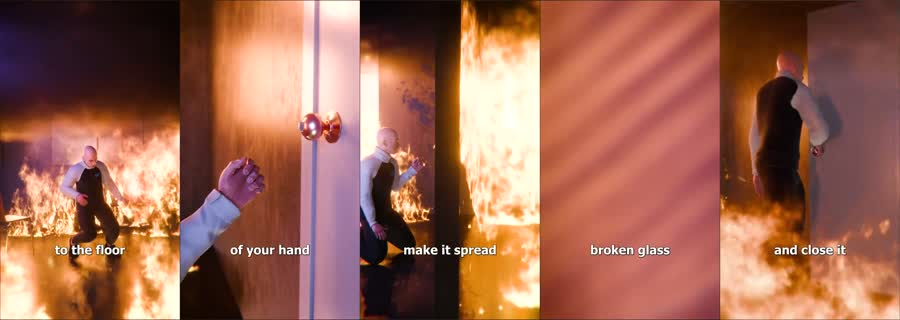
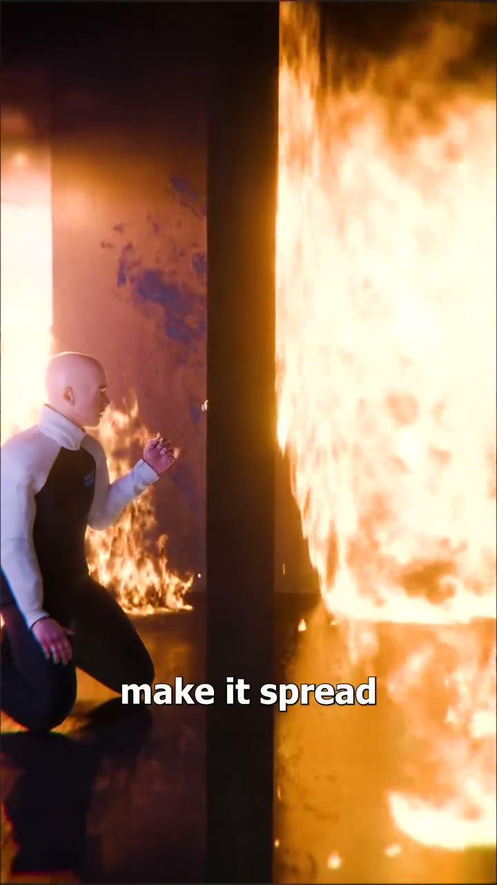

# Fireline: worked example

**Try:** `/fireline What to do when a kitchen fire blocks the door`

**Reference basis:** Observed, 1. The source clip is stored at [source-01.mp4](../../reference-videos/source-01.mp4). Screenshots are analysis samples, not assets to paste into a new production.

## Visual notes

Photographic orange fire against deep brown and black interiors; close hands, a door handle and a full-body escape action; white low captions. Hard cuts between body, hand and door; heat and flame remain a moving background; use readable close-ups at each decision.

## Sample script and matching shots

| Beat | Spoken line | Visual action | Sound cue |
|---|---|---|---|
| 1 | The room flashes orange. | Immediate danger and body movement. | Voice first; a subtle cue only at the visual change. |
| 2 | Get low. Feel the door. | Show the hand or object involved. | Voice first; a subtle cue only at the visual change. |
| 3 | If it is hot, turn back. | Return to the hazard to maintain stakes. | Voice first; a subtle cue only at the visual change. |
| 4 | Find another way out. | One short cutaway for the consequence. | Voice first; a subtle cue only at the visual change. |

The lines are an **original example**, not a transcript. Record them, measure each take, then assign real timestamps. Do not stretch the edit to a guessed runtime. End with the fifth beat as a visual resolution or question, with a final spoken line if the story needs one.

## Production check

- Every image changes in response to its line or a clearly planned silent beat.
- Captions follow actual speech, and the first screen can be read on a phone.
- The music remains below voice; no background cue competes with a key word.
- The last frame resolves the short rather than lingering over empty space.
- Never imply an unsafe emergency instruction from style alone; have practical safety wording checked against an authoritative source before publishing.
