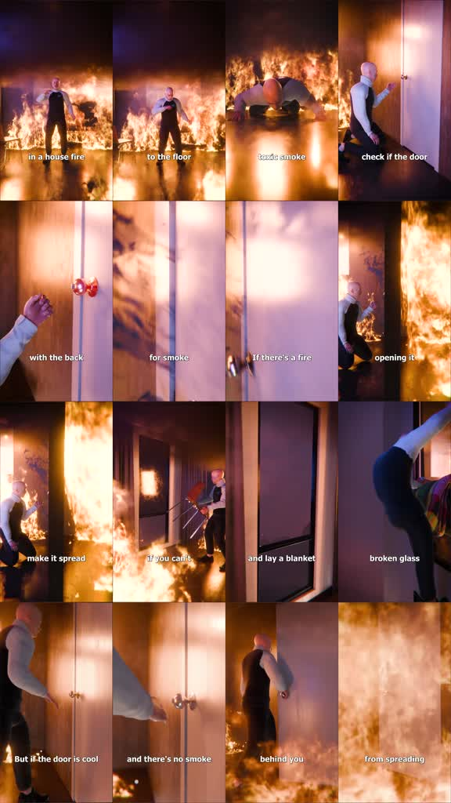

# /fireline: Fire escape reenactment

**Source-specific command:** `/fireline How to leave a smoke-filled hallway`

The [original clip](../../reference-videos/source-01.mp4) runs about 33 s in 9:16. Its source-specific structure is below. This new prompt uses the same audiovisual grammar with new wording and original visuals.

## Source beat map

| Source interval | Source visual role | Script role |
|---|---|---|
| 0–6 s | Person in burning room lowers to the floor | State the immediate action and why |
| 6–13 s | Hand and handle close-ups; smoke at door crack | Test before acting |
| 13–18 s | Door opens toward a wall of flame | Show the consequence of a wrong choice |
| 18–25 s | Window, blanket, broken-glass detail | Offer the alternate path |
| 25–33 s | Cool handle, slow opening, door closes behind person | Complete the conditional route |

## Original script sketch

These are new example lines, not a transcript of the source. They show how spoken meaning maps to a shot. Measure an actual voice recording before assigning final seconds.

| Beat | Spoken draft | Matching image |
|---|---|---|
| 1 | Smoke fills the hall. Get low. | Wide character and smoke, then floor-level camera |
| 2 | Check the door before opening it. | Hand and handle close-up |
| 3 | Heat means the danger is behind it. | A visible hot-door consequence |
| 4 | Find the marked alternate exit. | Window or route graphic |
| 5 | Leave carefully, then close the barrier. | Full-body exit and closing door |

## New-topic production brief

**Hook:** Begin inside an already dangerous room, with the character and flames visible at once.

**Visual rules:** Glossy 3D human reenactment; orange fire, black smoke, reflective floor, dark interior. Alternate a full body and extreme hand/door details. White lowercase captions sit near the bottom.

**Voice and sound:** Urgent but calm spoken instruction; constant low fire roar, small hand/door cues. The fire must never drown out the command.

**Adaptation:** Choose another physical emergency with a verifiable action tree. Write each branch clearly before designing visuals.

Draft original lines against these beat roles; record them and replace the source intervals with real voice timings. Each shot must illustrate its current phrase. Use the source as a style reference, not a set of frames to reuse.

**Check:** Safety guidance is consequential. Verify each instruction with an authoritative safety source before making a factual video.
