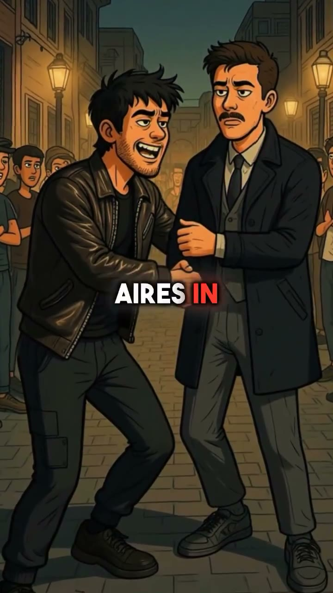

# Ink Case: worked example

**Try:** `/inkcase The guard who signed the order`

**Reference basis:** Observed, 7. The source clip is stored at [source-07.mp4](../../reference-videos/source-07.mp4). Screenshots are analysis samples, not assets to paste into a new production.

## Visual notes

Dark comic-book interiors, illustrated expressive faces, warm streetlamps, centered all-caps captions with red emphasis. Illustrated panels cut on spoken phrases; small camera push, expression change and rain or light movement make static art feel alive.

## Sample script and matching shots

| Beat | Spoken line | Visual action | Sound cue |
|---|---|---|---|
| 1 | He wore the badge with pride. | Official portrait. | Voice first; a subtle cue only at the visual change. |
| 2 | Then he signed the order. | Decisive act close-up. | Voice first; a subtle cue only at the visual change. |
| 3 | The crowd knew what it meant. | Public reaction. | Voice first; a subtle cue only at the visual change. |
| 4 | Did he have a choice? | Conflict between people. | Voice first; a subtle cue only at the visual change. |

The lines are an **original example**, not a transcript. Record them, measure each take, then assign real timestamps. Do not stretch the edit to a guessed runtime. End with the fifth beat as a visual resolution or question, with a final spoken line if the story needs one.

## Production check

- Every image changes in response to its line or a clearly planned silent beat.
- Captions follow actual speech, and the first screen can be read on a phone.
- The music remains below voice; no background cue competes with a key word.
- The last frame resolves the short rather than lingering over empty space.
- Do not identify a real person or historical act without verification.
