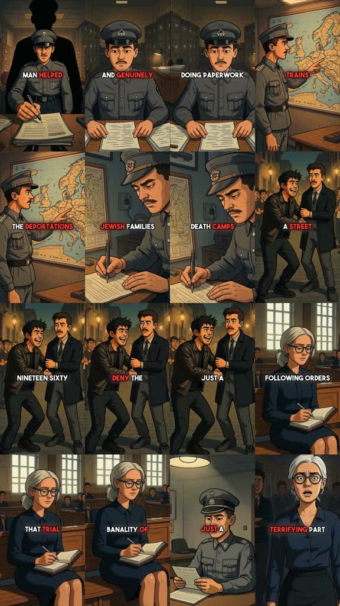

# /inkcase: Illustrated moral casefile

**Source-specific command:** `/inkcase The clerk who signed an unjust order`

The [original clip](../../reference-videos/source-07.mp4) runs about 33 s in 9:16. Its source-specific structure is below. This new prompt uses the same audiovisual grammar with new wording and original visuals.

## Source beat map

| Source interval | Source visual role | Script role |
|---|---|---|
| 0–6 s | Official at desk and direct question | Set moral tension |
| 6–14 s | Map, paperwork and signing hand | Make actions concrete |
| 14–21 s | Street arrest and courtroom context | Jump to consequences |
| 21–27 s | Defense and observer portrait | Show competing interpretations |
| 27–33 s | Subject alone and final observer reaction | Land the argument |

## Original script sketch

These are new example lines, not a transcript of the source. They show how spoken meaning maps to a shot. Measure an actual voice recording before assigning final seconds.

| Beat | Spoken draft | Matching image |
|---|---|---|
| 1 | How much harm can one signature do? | Official hand and document |
| 2 | The clerk processed the order. | Desk, map and papers |
| 3 | Families felt the consequence. | Street-level aftermath, depicted respectfully |
| 4 | Later, he said he only followed procedure. | Hearing room and face close-up |
| 5 | The record shows why the choice mattered. | Return to signed page and quiet closing image |

## New-topic production brief

**Hook:** Ask a provocative historical question while showing the person performing an ordinary administrative act.

**Visual rules:** Consistent hand-painted comic panels with warm brown offices and streets, expressive faces, official papers and maps. Centered bold white all-caps captions, selected key words red.

**Voice and sound:** Grave, nearly continuous narration; restrained room tone and minimal low hits. Do not use triumphant music or sensational effects.

**Adaptation:** Choose a documented ethical case with a clear action and interpretation. Keep the distinction between fact and analysis visible.

Draft original lines against these beat roles; record them and replace the source intervals with real voice timings. Each shot must illustrate its current phrase. Use the source as a style reference, not a set of frames to reuse.

**Check:** The reference concerns Holocaust atrocities. Verify details and depict victims respectfully.
