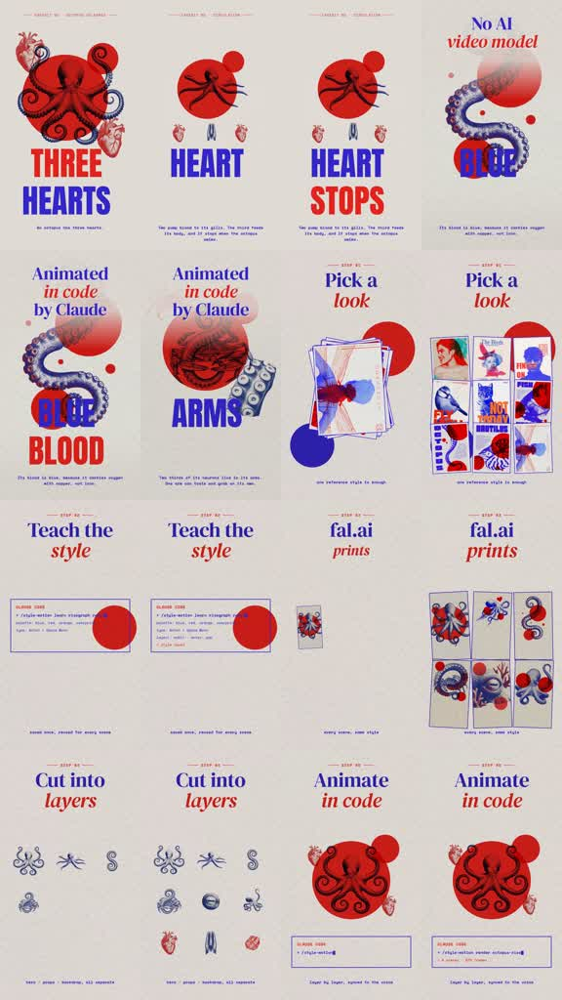

# /labnote: Octopus fact-card cut

**Try:** `/labnote Why an octopus has blue blood`

This is the 0–8 seconds of source 04; the source clip is [source-04.mp4](../../reference-videos/source-04.mp4).

## Original script sketch

These are new example lines, not a transcript of the source. They show how spoken meaning maps to a shot. Measure an actual voice recording before assigning final seconds.

| Beat | Spoken draft | Matching image |
|---|---|---|
| 1 | An octopus has more than one heart. | Big cobalt fact word over red circle |
| 2 | Two send blood toward its gills. | Separated organ and tentacle pieces |
| 3 | The third serves the rest of the body. | Assembled anatomical poster |

## The exact transferable style

- three large cobalt/red fact cards, anatomical cutouts, red circles and one illustrated octopus.
- Script progression: fact one → consequence → surprising exception.
- Audio: quick science voice and crisp word impacts; no process-tutorial section.

Make original art and script for the new topic, record speech, then cut visuals and captions to the actual take. Verify the fact; this is the fact-first opening of source 04, not a new reference video.
