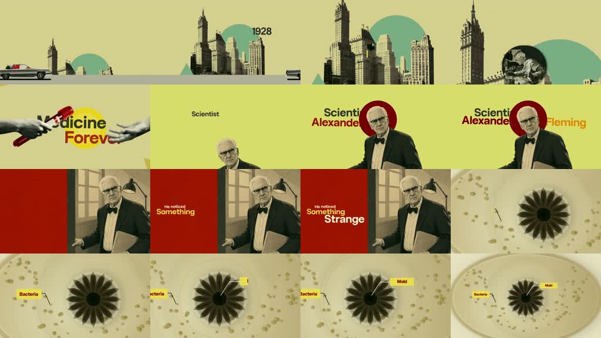

# /medarchive: Fleming fifteen-second archive

**Source-specific command:** `/medarchive A laboratory accident that changed a treatment`

The [original clip](../../reference-videos/source-06.mp4) runs about 16 s in 16:9. Its source-specific structure is below. This new prompt uses the same audiovisual grammar with new wording and original visuals.

## Source beat map

| Source interval | Source visual role | Script role |
|---|---|---|
| 0–5 s | Year/city collage and claim | Set date and importance |
| 5–10 s | Scientist portrait against red/pale panels | Name the observer and strange clue |
| 10–16 s | Specimen close-up with labels | Explain the finding and name its result |

## Original script sketch

These are new example lines, not a transcript of the source. They show how spoken meaning maps to a shot. Measure an actual voice recording before assigning final seconds.

| Beat | Spoken draft | Matching image |
|---|---|---|
| 1 | In one small laboratory, an accident left a clue. | Year and city card |
| 2 | A researcher noticed an unusual pattern. | Scientist portrait and red panel |
| 3 | The specimen changed the question. | Petri-style close-up and labels |

## New-topic production brief

**Hook:** Lead with a year and a claim about an accidental discovery.

**Visual rules:** True horizontal frame, pale yellow-green paper, red rectangular panels, old city skyline, cutout scientist portrait, circular microscope/petri specimen and tiny yellow labels.

**Voice and sound:** One continuous calm factual voice, very little pause across the three sentences; crisp transitional swooshes only.

**Adaptation:** Choose a different verified discovery that fits three sentences and three visual families. Keep a 16:9 export.

Draft original lines against these beat roles; record them and replace the source intervals with real voice timings. Each shot must illustrate its current phrase. Use the source as a style reference, not a set of frames to reuse.

**Check:** Fact-check the date, person and discovery.
