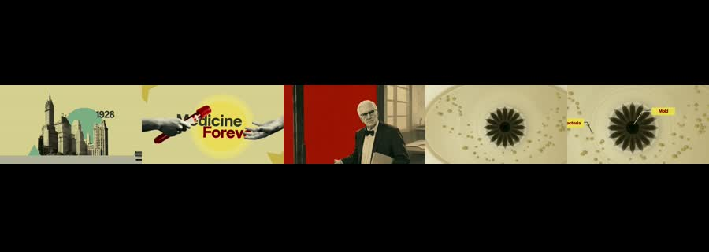
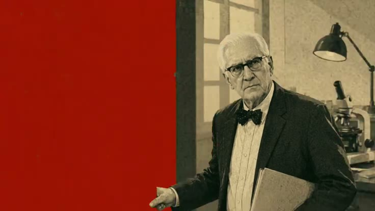

# Med Archive: worked example

**Try:** `/medarchive The laboratory that changed a city`

**Reference basis:** Observed, 6. The source clip is stored at [source-06.mp4](../../reference-videos/source-06.mp4). Screenshots are analysis samples, not assets to paste into a new production.

## Visual notes

16:9 letterbox, pale olive and mustard paper, old city silhouettes, cutout hand imagery, a seated historical figure, scientific specimen close-ups. Fast collage transitions within a narrow central image band; scale and pan on archival-style materials.

## Sample script and matching shots

| Beat | Spoken line | Visual action | Sound cue |
|---|---|---|---|
| 1 | In 1928, a new idea appeared. | Date or setting. | Voice first; a subtle cue only at the visual change. |
| 2 | A doctor tested the clue. | Big claim on screen. | Voice first; a subtle cue only at the visual change. |
| 3 | The specimen changed the question. | Human figure or inventor. | Voice first; a subtle cue only at the visual change. |
| 4 | The work traveled beyond the lab. | Scientific image. | Voice first; a subtle cue only at the visual change. |

The lines are an **original example**, not a transcript. Record them, measure each take, then assign real timestamps. Do not stretch the edit to a guessed runtime. End with the fifth beat as a visual resolution or question, with a final spoken line if the story needs one.

## Production check

- Every image changes in response to its line or a clearly planned silent beat.
- Captions follow actual speech, and the first screen can be read on a phone.
- The music remains below voice; no background cue competes with a key word.
- The last frame resolves the short rather than lingering over empty space.
- The reference date and medical premise are stylistic cues only; research any real-world claim before using it.
