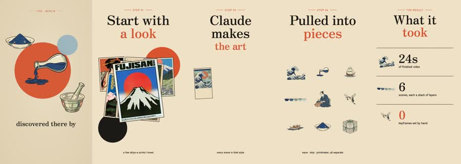

# Papertrail: worked example

**Try:** `/papertrail How we built a city guide from six illustrated scenes`

**Reference basis:** Observed, 2. The source clip is stored at [source-02.mp4](../../reference-videos/source-02.mp4). Screenshots are analysis samples, not assets to paste into a new production.

## Visual notes

Warm cream paper, oversized black serif headline, rust red emphasis, travel postcard and cut-paper objects, tiny labeled step headers. Objects slide and stack as paper layers; cards swap quickly while type holds; transitions feel like arranging a desk.

## Sample script and matching shots

| Beat | Spoken line | Visual action | Sound cue |
|---|---|---|---|
| 1 | First, choose a look. | The result or hook. | Voice first; a subtle cue only at the visual change. |
| 2 | Make each element separately. | The look board. | Voice first; a subtle cue only at the visual change. |
| 3 | Stack the scenes in layers. | The asset creation step. | Voice first; a subtle cue only at the visual change. |
| 4 | Now the city can move. | Layers and assembly. | Voice first; a subtle cue only at the visual change. |

The lines are an **original example**, not a transcript. Record them, measure each take, then assign real timestamps. Do not stretch the edit to a guessed runtime. End with the fifth beat as a visual resolution or question, with a final spoken line if the story needs one.

## Production check

- Every image changes in response to its line or a clearly planned silent beat.
- Captions follow actual speech, and the first screen can be read on a phone.
- The music remains below voice; no background cue competes with a key word.
- The last frame resolves the short rather than lingering over empty space.
- Do not claim the exact tool or hand-work count from the reference unless the new project actually used it.
