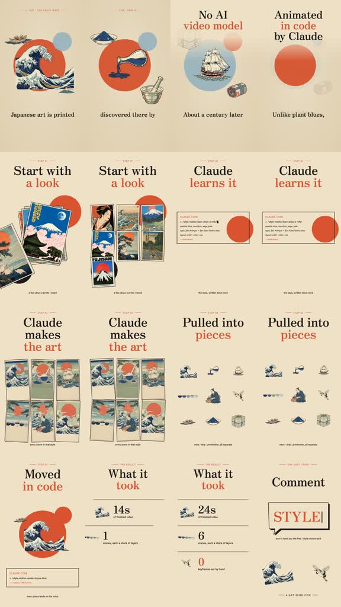
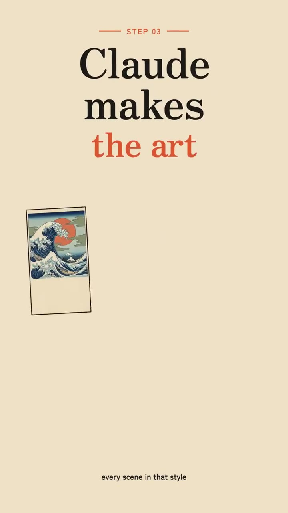

# /papertrail: Ukiyo-e process breakdown

**Source-specific command:** `/papertrail How I made an animated city postcard`

The [original clip](../../reference-videos/source-02.mp4) runs about 54 s in 9:16. Its source-specific structure is below. This new prompt uses the same audiovisual grammar with new wording and original visuals.

## Source beat map

| Source interval | Source visual role | Script role |
|---|---|---|
| 0–10 s | Wave and pigment collage, then process claim | Give proof-of-style and curiosity |
| 10–20 s | Large typography and reference postcard deck | Explain the chosen look |
| 20–34 s | Code-style rule card and scene-art grid | Describe consistency and asset creation |
| 34–45 s | Isolated pieces move, then the assembled image animates | Explain layer separation and code motion |
| 45–54 s | Large metrics, then a comment-style card | Quantify the result and call to action |

## Original script sketch

These are new example lines, not a transcript of the source. They show how spoken meaning maps to a shot. Measure an actual voice recording before assigning final seconds.

| Beat | Spoken draft | Matching image |
|---|---|---|
| 1 | This city postcard looks hand printed. | Finished animated street collage |
| 2 | First I chose the paper and ink. | Reference deck, cream paper and palette |
| 3 | Then I drew every scene to match. | Grid of consistent art cards |
| 4 | I separated signs, people and trains. | Objects pull apart into layers |
| 5 | The pieces move to the voice. | Assembled animated scene |
| 6 | Five scenes. One visual language. | Large result card, then optional CTA |

## New-topic production brief

**Hook:** Open with a compact cultural or material fact shown as an animated collage before explaining how that very clip was made.

**Visual rules:** Ivory paper field, black high-contrast serif headings, rust-red emphasis, Prussian blue waves and small cut-paper objects. Large circular color disks, postcard grids, code-card inserts and spare labels.

**Voice and sound:** Confident maker narration; short paper-slide and stamp cues at transitions, no distracting music under step labels.

**Adaptation:** For a new topic, first show a short finished sample, then teach exactly how that sample was assembled. Keep claims about tools and cost tied to the actual project.

Draft original lines against these beat roles; record them and replace the source intervals with real voice timings. Each shot must illustrate its current phrase. Use the source as a style reference, not a set of frames to reuse.

**Check:** Do not promise a tool, cost or hand-keyframe count that the new project did not actually achieve.
