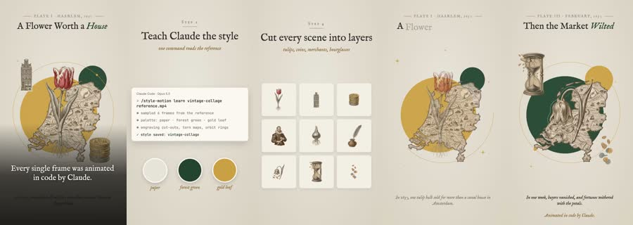
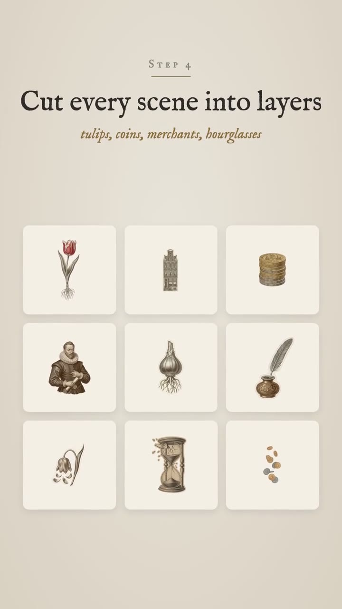

# Petalpress: worked example

**Try:** `/petalpress The tulip that bought a house`

**Reference basis:** Observed, 3. The source clip is stored at [source-03.mp4](../../reference-videos/source-03.mp4). Screenshots are analysis samples, not assets to paste into a new production.

## Visual notes

Aged ivory paper, delicate serif headings, botanical cutouts, dark forest green and mustard circles, tiny archival-style labels. Slow parallax of cutouts; isolated objects rearrange into scenes; small ornamental motion between otherwise still compositions.

## Sample script and matching shots

| Beat | Spoken line | Visual action | Sound cue |
|---|---|---|---|
| 1 | One flower drew every eye. | Title the curiosity. | Voice first; a subtle cue only at the visual change. |
| 2 | Its price kept climbing. | Reveal the visual grammar. | Voice first; a subtle cue only at the visual change. |
| 3 | Then the market wilted. | Show separated objects. | Voice first; a subtle cue only at the visual change. |
| 4 | The flower stayed. The fortune did not. | Build the desired object. | Voice first; a subtle cue only at the visual change. |

The lines are an **original example**, not a transcript. Record them, measure each take, then assign real timestamps. Do not stretch the edit to a guessed runtime. End with the fifth beat as a visual resolution or question, with a final spoken line if the story needs one.

## Production check

- Every image changes in response to its line or a clearly planned silent beat.
- Captions follow actual speech, and the first screen can be read on a phone.
- The music remains below voice; no background cue competes with a key word.
- The last frame resolves the short rather than lingering over empty space.
- Treat historical facts as research tasks; the aesthetic is evidence of style, not proof of an event.
