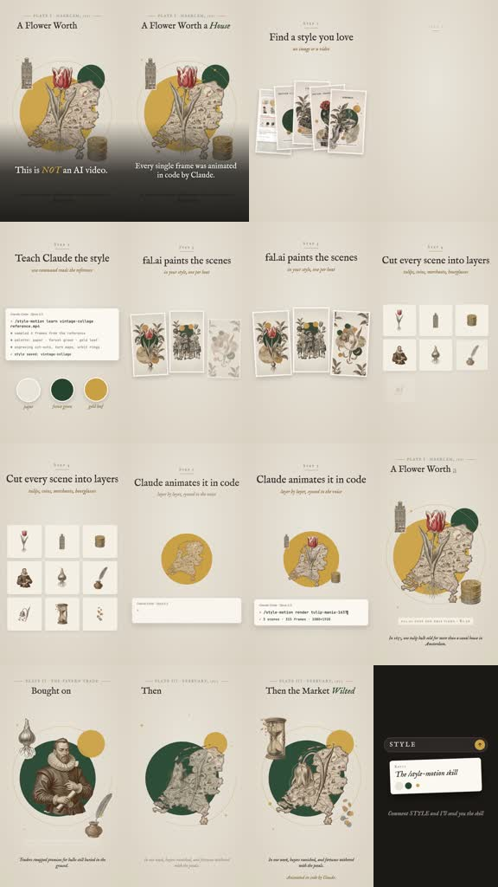

# /petalpress: Vintage tulip tutorial

**Source-specific command:** `/petalpress How I animated a vintage map story`

The [original clip](../../reference-videos/source-03.mp4) runs about 47 s in 9:16. Its source-specific structure is below. This new prompt uses the same audiovisual grammar with new wording and original visuals.

## Source beat map

| Source interval | Source visual role | Script role |
|---|---|---|
| 0–5 s | Antique flower title and complete collage | Show the finished output |
| 5–15 s | Reference stack and style rule card | Choose and describe the look |
| 15–21 s | Three scene print cards | Generate consistent illustrations |
| 21–27 s | Tulip, coins and people separated into a grid | Break art into independent parts |
| 27–37 s | Pieces reassemble and move over code-like strip | Show code animation and result |
| 37–47 s | The sample story returns, then a small style CTA | End with proof and invitation |

## Original script sketch

These are new example lines, not a transcript of the source. They show how spoken meaning maps to a shot. Measure an actual voice recording before assigning final seconds.

| Beat | Spoken draft | Matching image |
|---|---|---|
| 1 | This old map starts as a still picture. | Finished antique title plate |
| 2 | First I chose its ink and paper. | Reference stack and palette |
| 3 | Then I made matching scene cards. | Three art samples |
| 4 | Each ship and label became its own layer. | Specimen grid |
| 5 | Now the map can tell a moving story. | Reassembled parallax frame |

## New-topic production brief

**Hook:** Display the finished antique botanical story card immediately, then reveal the method used to animate it.

**Visual rules:** Aged ivory paper; fine serif titles and tiny plate labels; inked tulip, merchants and coins over mustard and deep green circles. Separate art is shown in a tidy specimen grid.

**Voice and sound:** Warm explanatory maker voice with explicit step markers; light paper texture and small tactile movement sounds. Let the final flower image breathe briefly.

**Adaptation:** Use another antique subject, but preserve the sample-first, numbered-method, sample-return structure.

Draft original lines against these beat roles; record them and replace the source intervals with real voice timings. Each shot must illustrate its current phrase. Use the source as a style reference, not a set of frames to reuse.

**Check:** The reference is a process tutorial, not a full standalone tulip documentary.
