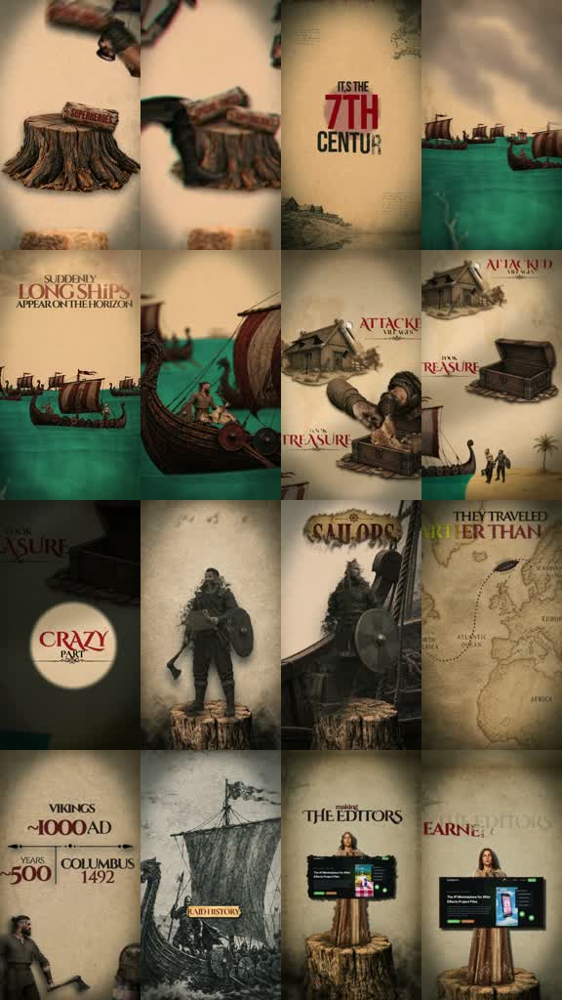

# /pulpchronicle: Viking reversal cut

**Try:** `/pulpchronicle The sailors who were more than raiders`

This is the about 24–44 seconds of source 05; the source clip is [source-05.mp4](../../reference-videos/source-05.mp4).

## Original script sketch

These are new example lines, not a transcript of the source. They show how spoken meaning maps to a shot. Measure an actual voice recording before assigning final seconds.

| Beat | Spoken draft | Matching image |
|---|---|---|
| 1 | Everyone remembers the raiders. | Sepia warrior portrait |
| 2 | But the sea carried traders too. | Red reversal card and teal ship |
| 3 | Their routes reached far beyond home. | Map and moving ship |
| 4 | The voyage changed the story. | Final parchment punchline |

## The exact transferable style

- sepia warrior portraits on parchment, teal ship/sea imagery, red serif reversal words and an exploration map.
- Script progression: accepted stereotype → “but” reversal → overlooked achievement → punchline.
- Audio: low documentary voice, small lift at the reversal and a decisive final hit.

Make original art and script for the new topic, record speech, then cut visuals and captions to the actual take. Research history. This is a short variant of source 05, not an independently supplied clip.
