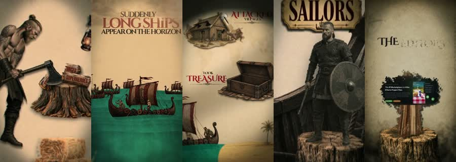
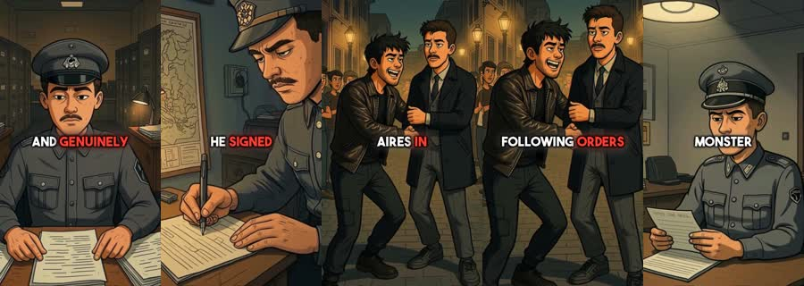
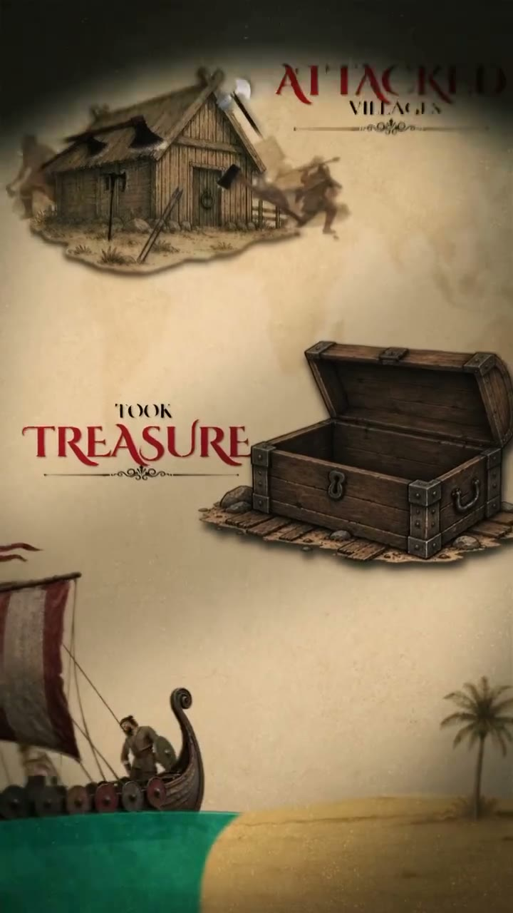

# Pulp Chronicle: worked example

**Try:** `/pulpchronicle The sailor who refused the order`

**Reference basis:** Hybrid of sources 05 and 07, 5+7. The source clip is stored at [source-05.mp4](../../reference-videos/source-05.mp4) and [source-07.mp4](../../reference-videos/source-07.mp4). Screenshots are analysis samples, not assets to paste into a new production.

## Visual notes

Parchment and teal-world establishing art from source 05, then expressive comic portraits and red caption words from source 07. Wide panorama cut to close inked panel; objects and facial reactions carry the turning point.

## Sample script and matching shots

| Beat | Spoken line | Visual action | Sound cue |
|---|---|---|---|
| 1 | The fleet reached the coast. | World and era. | Voice first; a subtle cue only at the visual change. |
| 2 | One sailor saw the warning. | Person. | Voice first; a subtle cue only at the visual change. |
| 3 | He refused the order. | Choice object. | Voice first; a subtle cue only at the visual change. |
| 4 | By morning, the harbor was empty. | Public consequence. | Voice first; a subtle cue only at the visual change. |

The lines are an **original example**, not a transcript. Record them, measure each take, then assign real timestamps. Do not stretch the edit to a guessed runtime. End with the fifth beat as a visual resolution or question, with a final spoken line if the story needs one.

## Production check

- Every image changes in response to its line or a clearly planned silent beat.
- Captions follow actual speech, and the first screen can be read on a phone.
- The music remains below voice; no background cue competes with a key word.
- The last frame resolves the short rather than lingering over empty space.
- Mark fictionalized reconstruction clearly and verify any factual history.
