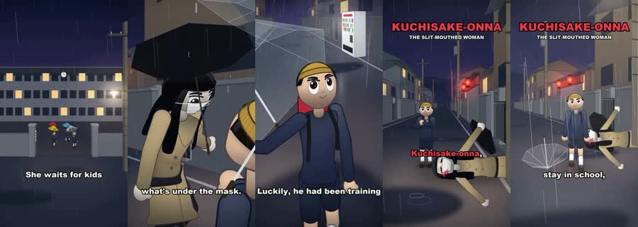

# Rain Myth: worked example

**Try:** `/rainmyth The woman at the crossing`

**Reference basis:** Observed, 10. The source clip is stored at [source-10.mp4](../../reference-videos/source-10.mp4). Screenshots are analysis samples, not assets to paste into a new production.

## Visual notes

Rainy blue-gray streets, simple round-headed 3D characters, dark umbrella silhouettes, red traffic light, a bold red creature-name card. Rain streaks throughout; lateral street travel, character turns and a short threat pose; title card holds over the action.

## Sample script and matching shots

| Beat | Spoken line | Visual action | Sound cue |
|---|---|---|---|
| 1 | She waits by the crossing. | Wide rainy setting. | Voice first; a subtle cue only at the visual change. |
| 2 | Under the umbrella, she smiles. | Threat under umbrella. | Voice first; a subtle cue only at the visual change. |
| 3 | The boy remembers the warning. | Child reaction. | Voice first; a subtle cue only at the visual change. |
| 4 | He walks past without answering. | Name and reveal. | Voice first; a subtle cue only at the visual change. |

The lines are an **original example**, not a transcript. Record them, measure each take, then assign real timestamps. Do not stretch the edit to a guessed runtime. End with the fifth beat as a visual resolution or question, with a final spoken line if the story needs one.

## Production check

- Every image changes in response to its line or a clearly planned silent beat.
- Captions follow actual speech, and the first screen can be read on a phone.
- The music remains below voice; no background cue competes with a key word.
- The last frame resolves the short rather than lingering over empty space.
- Do not claim a folklore detail is authentic without research; present original adaptations as such.
