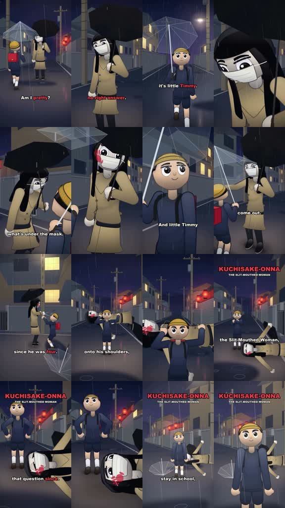
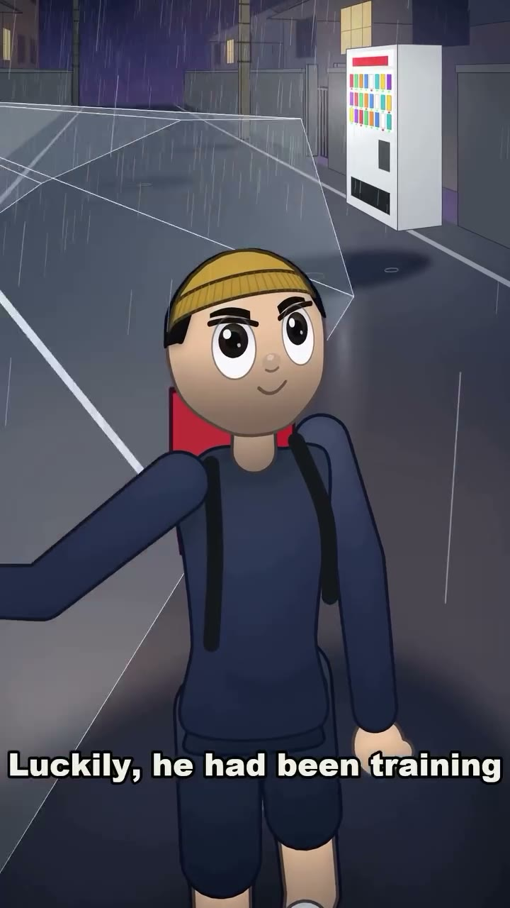

# /rainmyth: Kuchisake-onna comic 3D short

**Source-specific command:** `/rainmyth The umbrella woman at the crossing`

The [original clip](../../reference-videos/source-10.mp4) runs about 57 s in 9:16. Its source-specific structure is below. This new prompt uses the same audiovisual grammar with new wording and original visuals.

## Source beat map

| Source interval | Source visual role | Script role |
|---|---|---|
| 0–10 s | Rainy street, masked figure, child approach | Introduce question and setting |
| 10–18 s | Alternating face close-ups, mask reveal | Define the trap |
| 18–28 s | Child’s unexpected response and antagonist reaction | Reverse expectation |
| 28–38 s | Clear grappling action in a few wide poses | Pay off reversal |
| 38–45 s | Red creature title over street | Name and resolve |
| 45–57 s | Child and aftermath, direct comic sign-off | Close the joke |

## Original script sketch

These are new example lines, not a transcript of the source. They show how spoken meaning maps to a shot. Measure an actual voice recording before assigning final seconds.

| Beat | Spoken draft | Matching image |
|---|---|---|
| 1 | Who walks under the clear umbrella? | Rainy street wide |
| 2 | The stranger asks the same question twice. | Alternating masked figure and child close-ups |
| 3 | The child answers with a ridiculous trick. | Unexpected response and antagonist reaction |
| 4 | One clumsy move turns the chase around. | Readable wide action poses |
| 5 | By morning, the legend has a new ending. | Red creature title and comic aftermath |

## New-topic production brief

**Hook:** Open on a rainy street with a repeated threatening question and immediately identify the folklore premise.

**Visual rules:** Simple round-headed 3D characters, wet blue-gray Japanese street, transparent umbrella shapes and rain streaks, mask/scissors threat, bright red name card over the street. Child and antagonist remain visually distinct.

**Voice and sound:** Rain bed throughout; narrator and brief character lines remain distinguishable. Action hits land on contact, followed by comic space for the joke.

**Adaptation:** Invent a new urban legend scene with a question/trap and a surprising comic reversal. Keep action readable and the joke tied to the established danger.

Draft original lines against these beat roles; record them and replace the source intervals with real voice timings. Each shot must illustrate its current phrase. Use the source as a style reference, not a set of frames to reuse.

**Check:** Differentiate folklore adaptation from documented tradition; do not use the source character designs or dialogue verbatim.
