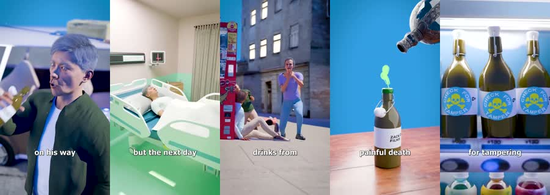

# Real Case: worked example

**Try:** `/realcase The mislabeled bottle`

**Reference basis:** Observed, 9. The source clip is stored at [source-09.mp4](../../reference-videos/source-09.mp4). Screenshots are analysis samples, not assets to paste into a new production.

## Visual notes

Bright photo-real scenes: vehicle, hospital, street confrontation, clean blue product close-up, shelf of bottles; small white bottom captions. Frequent direct cuts, subject action in each scene, product hero close-up near the end; no animated diagram detour.

## Sample script and matching shots

| Beat | Spoken line | Visual action | Sound cue |
|---|---|---|---|
| 1 | He picked up the bottle. | Person and setting. | Voice first; a subtle cue only at the visual change. |
| 2 | Hours later, he was in the hospital. | Immediate consequence. | Voice first; a subtle cue only at the visual change. |
| 3 | The label hid the mistake. | Public reaction. | Voice first; a subtle cue only at the visual change. |
| 4 | Then investigators checked the shelf. | Object close-up. | Voice first; a subtle cue only at the visual change. |

The lines are an **original example**, not a transcript. Record them, measure each take, then assign real timestamps. Do not stretch the edit to a guessed runtime. End with the fifth beat as a visual resolution or question, with a final spoken line if the story needs one.

## Production check

- Every image changes in response to its line or a clearly planned silent beat.
- Captions follow actual speech, and the first screen can be read on a phone.
- The music remains below voice; no background cue competes with a key word.
- The last frame resolves the short rather than lingering over empty space.
- For real incidents, identify sources and avoid fabricated details or misleading dramatization.
