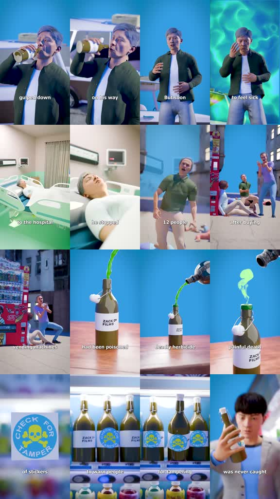
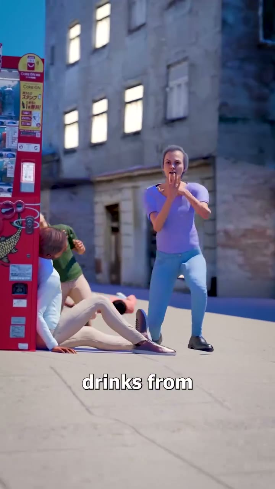

# /realcase: Poisoned-drink 3D reconstruction

**Source-specific command:** `/realcase The mislabeled vending-machine drink`

The [original clip](../../reference-videos/source-09.mp4) runs about 30 s in 9:16. Its source-specific structure is below. This new prompt uses the same audiovisual grammar with new wording and original visuals.

## Source beat map

| Source interval | Source visual role | Script role |
|---|---|---|
| 0–7 s | Man drinking beside vehicle | Normal action and first symptom |
| 7–11 s | Hospital bed | Consequence |
| 11–17 s | Street machine and multiple people | Reveal wider pattern |
| 17–22 s | Bottle, green poison and close insert | Explain mechanism |
| 22–27 s | Sticker and rows of drinks | Show response |
| 27–30 s | Unresolved figure or empty machine | End with uncertainty |

## Original script sketch

These are new example lines, not a transcript of the source. They show how spoken meaning maps to a shot. Measure an actual voice recording before assigning final seconds.

| Beat | Spoken draft | Matching image |
|---|---|---|
| 1 | He bought one bottle before the trip. | Ordinary person and bottle |
| 2 | By evening, something felt wrong. | Distress close-up |
| 3 | The hospital could not explain it at first. | Clinical room |
| 4 | Investigators checked the other bottles. | Isolated product and shelf |
| 5 | The warning reached every machine. | Warning sticker and wider row |

## New-topic production brief

**Hook:** Begin with an ordinary person using an everyday product, then turn quickly to an unexpected medical consequence.

**Visual rules:** Bright, smooth 3D reenactment: vehicle/drink, green-tinted distress, hospital, street vending machine, isolated bottle with vivid green liquid, warning sticker and shelf. Small white sentence-case captions low on frame.

**Voice and sound:** Tense neutral reporter voice, realistic atmosphere and a slight ominous pulse; do not make a sensational impact at the victim’s death.

**Adaptation:** Use only a documented incident or label a fictional reconstruction. Preserve the repeated object and widening scope.

Draft original lines against these beat roles; record them and replace the source intervals with real voice timings. Each shot must illustrate its current phrase. Use the source as a style reference, not a set of frames to reuse.

**Check:** Do not invent victims, causes or outcomes while presenting an incident as real.
