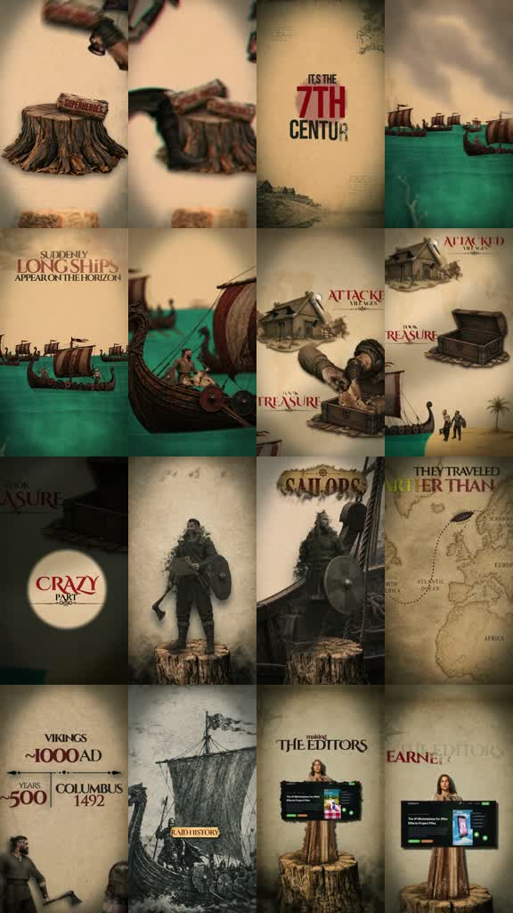
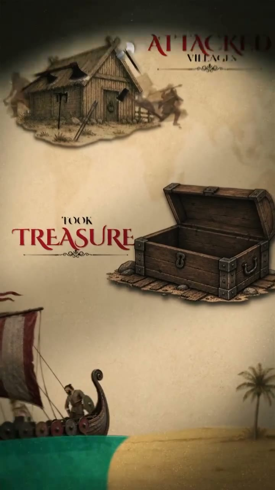

# /sagacut: Viking parchment documentary

**Source-specific command:** `/sagacut The sailors who crossed an impossible sea`

The [original clip](../../reference-videos/source-05.mp4) runs about 50 s in 9:16. Its source-specific structure is below. This new prompt uses the same audiovisual grammar with new wording and original visuals.

## Source beat map

| Source interval | Source visual role | Script role |
|---|---|---|
| 0–7 s | Hero character on parchment with a historical claim | Set the mythic frame |
| 7–15 s | Era title, Scandinavian coast, ships on teal sea | Place and threaten |
| 15–25 s | Village and treasure objects; departure to sea | Show the raid sequence |
| 25–34 s | Portraits and revised claim about the people | Reverse the simple stereotype |
| 34–44 s | Map/reach/ship image and line of synthesis | Show wider legacy |
| 44–50 s | Clearly separated project-file end card | Promotion only if requested |

## Original script sketch

These are new example lines, not a transcript of the source. They show how spoken meaning maps to a shot. Measure an actual voice recording before assigning final seconds.

| Beat | Spoken draft | Matching image |
|---|---|---|
| 1 | Before the maps were complete, they sailed. | Rugged portrait on parchment |
| 2 | The northern sea was their road. | Wide teal water and ships |
| 3 | Some came to raid. | Village and treasure inserts |
| 4 | But others crossed to trade. | Reversal word card and new character |
| 5 | Their routes redrew the world they knew. | Travel map and final ship silhouette |

## New-topic production brief

**Hook:** Open with a grand historical contrast and a single rugged character or artifact before revealing the place and era.

**Visual rules:** Weathered parchment, sepia illustrated figures, vignette and grunge, bold red/dark historical serif type, deep teal sea, longships, treasure and map inserts.

**Voice and sound:** Gravelly documentary narration with sea/wind texture, martial pulse for raids, lift at the reversal, then a clean tonal change for the promotion.

**Adaptation:** Use the same threat-to-reversal history arc for a researched subject. Keep an ad outro only when the user asks for one.

Draft original lines against these beat roles; record them and replace the source intervals with real voice timings. Each shot must illustrate its current phrase. Use the source as a style reference, not a set of frames to reuse.

**Check:** Research historical claims; do not present the supplied narration as an authoritative source.
