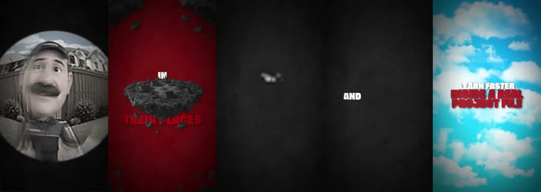
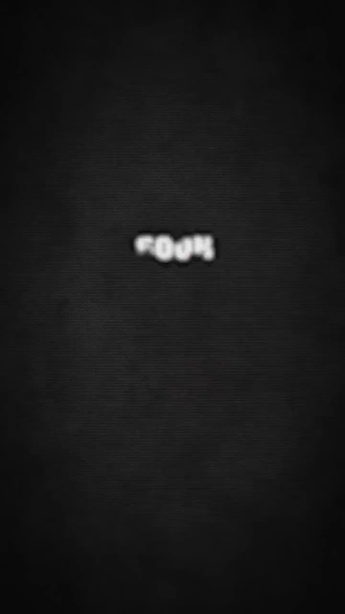

# Zackd: worked example

**Try:** `/zackd Why I'm afraid of being forgotten`

**Reference basis:** Observed, 8. The source clip is stored at [source-08.mp4](../../reference-videos/source-08.mp4). Screenshots are analysis samples, not assets to paste into a new production.

## Visual notes

Near-black backgrounds, blood-red voids, a tiny bright central subject, giant blunt type, fisheye face insert, sky-blue release frame. Abrupt high-contrast scene replacement, zoom into central subject, text punches on key words; little decorative movement.

## Sample script and matching shots

| Beat | Spoken line | Visual action | Sound cue |
|---|---|---|---|
| 1 | I'm afraid of disappearing. | Unsettling face or question. | Voice first; a subtle cue only at the visual change. |
| 2 | Not all at once. | Red void and central symbol. | Voice first; a subtle cue only at the visual change. |
| 3 | Just one missed memory at a time. | Dark near-empty beat. | Voice first; a subtle cue only at the visual change. |
| 4 | So I leave something behind. | Single-word assertion. | Voice first; a subtle cue only at the visual change. |

The lines are an **original example**, not a transcript. Record them, measure each take, then assign real timestamps. Do not stretch the edit to a guessed runtime. End with the fifth beat as a visual resolution or question, with a final spoken line if the story needs one.

## Production check

- Every image changes in response to its line or a clearly planned silent beat.
- Captions follow actual speech, and the first screen can be read on a phone.
- The music remains below voice; no background cue competes with a key word.
- The last frame resolves the short rather than lingering over empty space.
- Do not use the creator name as a claim of authorship; this is an internal command name for a visual treatment.
