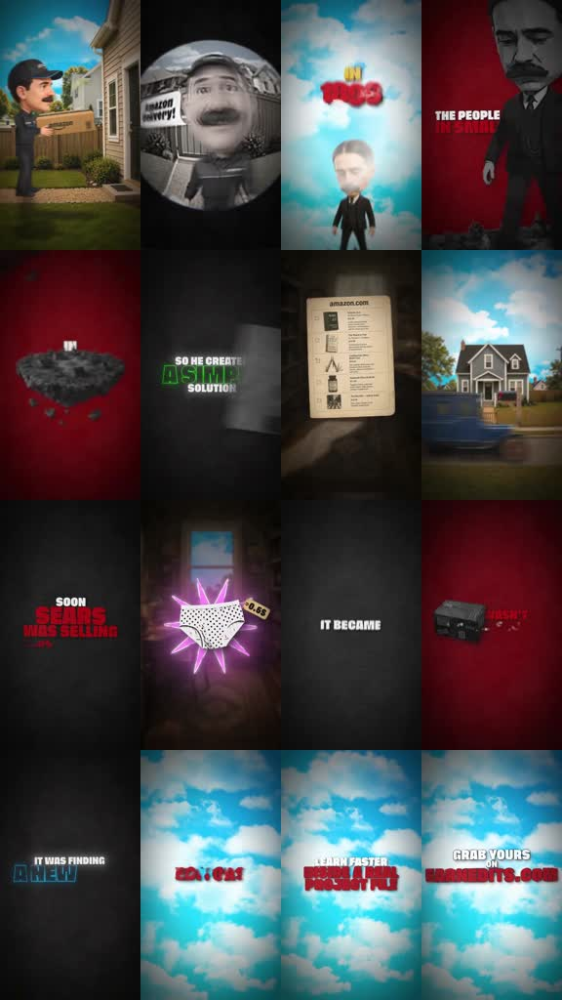

# /zackd: Sears-style kinetic 3D history

**Source-specific command:** `/zackd Why I'm afraid of being forgotten`

The [original clip](../../reference-videos/source-08.mp4) runs about 38 s in 9:16. Its source-specific structure is below. This new prompt uses the same audiovisual grammar with new wording and original visuals.

## Source beat map

| Source interval | Source visual role | Script role |
|---|---|---|
| 0–5 s | 3D delivery scene and modern analogy | Set familiar frame |
| 5–12 s | Historical portrait/date and red problem space | Establish person and constraint |
| 12–19 s | Catalog close-up and order flow | Reveal simple solution |
| 19–26 s | Product parade then dark scale card | Show expansion |
| 26–31 s | Minimal type and small object | State the principle |
| 31–38 s | Bright sky and separate promotional CTA | Only if requested |

## Original script sketch

These are new example lines, not a transcript of the source. They show how spoken meaning maps to a shot. Measure an actual voice recording before assigning final seconds.

| Beat | Spoken draft | Matching image |
|---|---|---|
| 1 | We can reach anyone in a second. | Bright 3D modern delivery image |
| 2 | So why am I afraid of being forgotten? | Red/black problem void and giant question type |
| 3 | I keep waiting for someone else to remember. | Character close-up and tiny central object |
| 4 | But I can leave a story they can carry. | Simple mechanism represented by a book or message |
| 5 | Maybe being remembered starts with showing up. | Minimal insight card, then bright release |

## New-topic production brief

**Hook:** Start with a familiar modern comparison, then reveal a historical person who solved the same customer problem earlier.

**Visual rules:** Stylized, cartoonlike 3D human scenes alternate with black and crimson voids. Giant white/red block type punches selected words; bright cyan sky fields open the beginning and promotional ending. An old catalog and product objects become hero props.

**Voice and sound:** Fast, conversational explainer narrator, hard hits on business turns, brief quiet before the business principle, brighter sales sound only in the outro.

**Adaptation:** For a personal question such as “why I’m afraid,” use the modern comparison → underlying problem → simple mechanism → consequence → insight rhythm; keep 3D scenes and red/black typography. Do not claim it is the source story.

Draft original lines against these beat roles; record them and replace the source intervals with real voice timings. Each shot must illustrate its current phrase. Use the source as a style reference, not a set of frames to reuse.

**Check:** The reference is a commerce-history explainer; the example topic is a new application of its audiovisual grammar.
